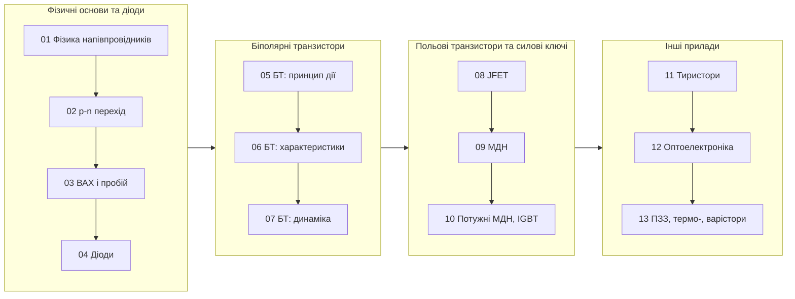

<div align="center">

# 🔌 Електронні прилади та мікроелектроніка

**Інтерактивний конспект лекцій і лабораторні роботи українською мовою**

Національний університет «Чернігівська політехніка»

[](https://mybinder.org/v2/gh/vim4all/Lectures_Electronic_devices/HEAD)
[](https://github.com/vim4all/Lectures_Electronic_devices/actions/workflows/notebooks.yml)


</div>

---

<table>
<tr>
<td width="130" align="center"></td>
<td>

**Викладач:** Пахалюк Богдан Петрович, доктор філософії

**Дисципліна:** Електронні прилади та мікроелектроніка (13 лекцій, 4 лабораторні роботи)

**Мова викладання:** українська

</td>
</tr>
</table>

## ✨ Що всередині

Кожна лекція — окремий Jupyter-зошит, який можна відкрити й виконати незалежно від інших.

- 📖 **Теорія** з формулами, зонними діаграмами та фізичними моделями приладів
- 🔌 **Схеми**, побудовані кодом у [SchemDraw](https://schemdraw.readthedocs.io/) з умовними позначеннями за ДСТУ
- 🔬 **Інтерактивні графіки**: змінюйте параметри повзунками й одразу бачте результат
- ⚙️ **Моделювання** реальних приладів (1N4148, 2N3904, BF245B, 2N7000, IRF540, IGBT…) у [PySpice](https://pyspice.fabrice-salvaire.fr/) + [ngspice](https://ngspice.sourceforge.io/); SPICE-моделі — у теці `models/`
- 🧪 **Лабораторні роботи** виконуються SPICE-моделюванням із чисельною обробкою результатів (замість TINA)
- ✅ **Питання для самоперевірки** та 📝 **задачі** для самостійного розв'язання в кожному розділі

## 🗺️ Карта курсу



## 📚 Зміст

> Натисніть назву теми, щоб переглянути її на GitHub, або ▶️, щоб запустити в Binder (без встановлення, у браузері).

### Частина 1 · фізичні основи та напівпровідникові діоди

| № | Тема | Ключові питання | Binder |
|:---:|---|---|:---:|
| **01** | [Фізичні основи напівпровідників](Лекція_01_Фізичні_основи_напівпровідників.ipynb) | енергетичні зони, власні та домішкові напівпровідники, рівень Фермі, n(T), дрейф і дифузія, час життя | [▶️](https://mybinder.org/v2/gh/vim4all/Lectures_Electronic_devices/HEAD?labpath=%D0%9B%D0%B5%D0%BA%D1%86%D1%96%D1%8F_01_%D0%A4%D1%96%D0%B7%D0%B8%D1%87%D0%BD%D1%96_%D0%BE%D1%81%D0%BD%D0%BE%D0%B2%D0%B8_%D0%BD%D0%B0%D0%BF%D1%96%D0%B2%D0%BF%D1%80%D0%BE%D0%B2%D1%96%D0%B4%D0%BD%D0%B8%D0%BA%D1%96%D0%B2.ipynb) |
| **02** | [Електронно-дірковий (p-n) перехід](Лекція_02_Електронно-дірковий_перехід.ipynb) | утворення p-n переходу, контактна різниця потенціалів, ОПЗ, бар'єрна ємність, варикап, контакт метал–напівпровідник | [▶️](https://mybinder.org/v2/gh/vim4all/Lectures_Electronic_devices/HEAD?labpath=%D0%9B%D0%B5%D0%BA%D1%86%D1%96%D1%8F_02_%D0%95%D0%BB%D0%B5%D0%BA%D1%82%D1%80%D0%BE%D0%BD%D0%BD%D0%BE-%D0%B4%D1%96%D1%80%D0%BA%D0%BE%D0%B2%D0%B8%D0%B9_%D0%BF%D0%B5%D1%80%D0%B5%D1%85%D1%96%D0%B4.ipynb) |
| **03** | [Вольт-амперна характеристика діода. Пробій і перехідні процеси](Лекція_03_Вольт-амперна_характеристика_діода.ipynb) | ідеалізована та реальна ВАХ, тунельний, лавинний і тепловий пробій, температурні властивості, перехідні процеси | [▶️](https://mybinder.org/v2/gh/vim4all/Lectures_Electronic_devices/HEAD?labpath=%D0%9B%D0%B5%D0%BA%D1%86%D1%96%D1%8F_03_%D0%92%D0%BE%D0%BB%D1%8C%D1%82-%D0%B0%D0%BC%D0%BF%D0%B5%D1%80%D0%BD%D0%B0_%D1%85%D0%B0%D1%80%D0%B0%D0%BA%D1%82%D0%B5%D1%80%D0%B8%D1%81%D1%82%D0%B8%D0%BA%D0%B0_%D0%B4%D1%96%D0%BE%D0%B4%D0%B0.ipynb) |
| **04** | [Напівпровідникові діоди та їх застосування](Лекція_04_Напівпровідникові_діоди_та_їх_застосування.ipynb) | випрямні діоди й випрямлячі, з'єднання діодів, діоди Шотки, стабілітрони, тунельні й обернені діоди | [▶️](https://mybinder.org/v2/gh/vim4all/Lectures_Electronic_devices/HEAD?labpath=%D0%9B%D0%B5%D0%BA%D1%86%D1%96%D1%8F_04_%D0%9D%D0%B0%D0%BF%D1%96%D0%B2%D0%BF%D1%80%D0%BE%D0%B2%D1%96%D0%B4%D0%BD%D0%B8%D0%BA%D0%BE%D0%B2%D1%96_%D0%B4%D1%96%D0%BE%D0%B4%D0%B8_%D1%82%D0%B0_%D1%97%D1%85_%D0%B7%D0%B0%D1%81%D1%82%D0%BE%D1%81%D1%83%D0%B2%D0%B0%D0%BD%D0%BD%D1%8F.ipynb) |

### Частина 2 · біполярні транзистори

| № | Тема | Ключові питання | Binder |
|:---:|---|---|:---:|
| **05** | [Біполярний транзистор: будова, принцип дії, режими](Лекція_05_Біполярний_транзистор_принцип_дії.ipynb) | будова, режими роботи, інжекція й перенесення носіїв, модель Еберса–Молла, схеми ввімкнення | [▶️](https://mybinder.org/v2/gh/vim4all/Lectures_Electronic_devices/HEAD?labpath=%D0%9B%D0%B5%D0%BA%D1%86%D1%96%D1%8F_05_%D0%91%D1%96%D0%BF%D0%BE%D0%BB%D1%8F%D1%80%D0%BD%D0%B8%D0%B9_%D1%82%D1%80%D0%B0%D0%BD%D0%B7%D0%B8%D1%81%D1%82%D0%BE%D1%80_%D0%BF%D1%80%D0%B8%D0%BD%D1%86%D0%B8%D0%BF_%D0%B4%D1%96%D1%97.ipynb) |
| **06** | [Статичні характеристики та параметри біполярного транзистора](Лекція_06_Статичні_характеристики_біполярного_транзистора.ipynb) | вхідні й вихідні характеристики СЕ і СБ, ефект Ерлі, h-параметри, β(I, T), пробій, ОБР | [▶️](https://mybinder.org/v2/gh/vim4all/Lectures_Electronic_devices/HEAD?labpath=%D0%9B%D0%B5%D0%BA%D1%86%D1%96%D1%8F_06_%D0%A1%D1%82%D0%B0%D1%82%D0%B8%D1%87%D0%BD%D1%96_%D1%85%D0%B0%D1%80%D0%B0%D0%BA%D1%82%D0%B5%D1%80%D0%B8%D1%81%D1%82%D0%B8%D0%BA%D0%B8_%D0%B1%D1%96%D0%BF%D0%BE%D0%BB%D1%8F%D1%80%D0%BD%D0%BE%D0%B3%D0%BE_%D1%82%D1%80%D0%B0%D0%BD%D0%B7%D0%B8%D1%81%D1%82%D0%BE%D1%80%D0%B0.ipynb) |
| **07** | [Біполярний транзистор у підсилювальному та ключовому режимах](Лекція_07_Біполярний_транзистор_у_динамічному_режимі.ipynb) | гібридна П-подібна модель, частотні властивості, підсилювальний каскад, ключ і час розсмоктування | [▶️](https://mybinder.org/v2/gh/vim4all/Lectures_Electronic_devices/HEAD?labpath=%D0%9B%D0%B5%D0%BA%D1%86%D1%96%D1%8F_07_%D0%91%D1%96%D0%BF%D0%BE%D0%BB%D1%8F%D1%80%D0%BD%D0%B8%D0%B9_%D1%82%D1%80%D0%B0%D0%BD%D0%B7%D0%B8%D1%81%D1%82%D0%BE%D1%80_%D1%83_%D0%B4%D0%B8%D0%BD%D0%B0%D0%BC%D1%96%D1%87%D0%BD%D0%BE%D0%BC%D1%83_%D1%80%D0%B5%D0%B6%D0%B8%D0%BC%D1%96.ipynb) |

### Частина 3 · польові транзистори та силові ключі

| № | Тема | Ключові питання | Binder |
|:---:|---|---|:---:|
| **08** | [Польові транзистори з керуючим p-n переходом](Лекція_08_Польові_транзистори_з_керуючим_pn_переходом.ipynb) | будова і принцип дії JFET, вихідні та передавальна характеристики, автозміщення, керований опір | [▶️](https://mybinder.org/v2/gh/vim4all/Lectures_Electronic_devices/HEAD?labpath=%D0%9B%D0%B5%D0%BA%D1%86%D1%96%D1%8F_08_%D0%9F%D0%BE%D0%BB%D1%8C%D0%BE%D0%B2%D1%96_%D1%82%D1%80%D0%B0%D0%BD%D0%B7%D0%B8%D1%81%D1%82%D0%BE%D1%80%D0%B8_%D0%B7_%D0%BA%D0%B5%D1%80%D1%83%D1%8E%D1%87%D0%B8%D0%BC_pn_%D0%BF%D0%B5%D1%80%D0%B5%D1%85%D0%BE%D0%B4%D0%BE%D0%BC.ipynb) |
| **09** | [МДН-транзистори (MOSFET)](Лекція_09_МДН-транзистори.ipynb) | МДН-структура, порогова напруга, C-V характеристика, типи МДН, підпороговий режим, КМОН-інвертор | [▶️](https://mybinder.org/v2/gh/vim4all/Lectures_Electronic_devices/HEAD?labpath=%D0%9B%D0%B5%D0%BA%D1%86%D1%96%D1%8F_09_%D0%9C%D0%94%D0%9D-%D1%82%D1%80%D0%B0%D0%BD%D0%B7%D0%B8%D1%81%D1%82%D0%BE%D1%80%D0%B8.ipynb) |
| **10** | [Динамічні властивості польових транзисторів. Потужні МДН-транзистори та IGBT](Лекція_10_Динаміка_ПТ_потужні_МДН_та_IGBT.ipynb) | ємності МДН, заряд затвора й плато Міллера, VDMOS, IGBT, порівняння силових ключів | [▶️](https://mybinder.org/v2/gh/vim4all/Lectures_Electronic_devices/HEAD?labpath=%D0%9B%D0%B5%D0%BA%D1%86%D1%96%D1%8F_10_%D0%94%D0%B8%D0%BD%D0%B0%D0%BC%D1%96%D0%BA%D0%B0_%D0%9F%D0%A2_%D0%BF%D0%BE%D1%82%D1%83%D0%B6%D0%BD%D1%96_%D0%9C%D0%94%D0%9D_%D1%82%D0%B0_IGBT.ipynb) |

### Частина 4 · тиристори, оптоелектроніка, інші прилади

| № | Тема | Ключові питання | Binder |
|:---:|---|---|:---:|
| **11** | [Тиристорні прилади](Лекція_11_Тиристорні_прилади.ipynb) | p-n-p-n структура, диністор, тиристор, симістор, керовані випрямлячі, ввімкнення та вимкнення | [▶️](https://mybinder.org/v2/gh/vim4all/Lectures_Electronic_devices/HEAD?labpath=%D0%9B%D0%B5%D0%BA%D1%86%D1%96%D1%8F_11_%D0%A2%D0%B8%D1%80%D0%B8%D1%81%D1%82%D0%BE%D1%80%D0%BD%D1%96_%D0%BF%D1%80%D0%B8%D0%BB%D0%B0%D0%B4%D0%B8.ipynb) |
| **12** | [Оптоелектронні прилади](Лекція_12_Оптоелектронні_прилади.ipynb) | фоторезистори, фотодіоди, сонячні елементи, світлодіоди, оптрони | [▶️](https://mybinder.org/v2/gh/vim4all/Lectures_Electronic_devices/HEAD?labpath=%D0%9B%D0%B5%D0%BA%D1%86%D1%96%D1%8F_12_%D0%9E%D0%BF%D1%82%D0%BE%D0%B5%D0%BB%D0%B5%D0%BA%D1%82%D1%80%D0%BE%D0%BD%D0%BD%D1%96_%D0%BF%D1%80%D0%B8%D0%BB%D0%B0%D0%B4%D0%B8.ipynb) |
| **13** | [Прилади із зарядовим зв'язком, терморезистори та варістори](Лекція_13_ПЗЗ_терморезистори_варістори.ipynb) | прилади із зарядовим зв'язком, терморезистори (NTC, PTC), варістори і захист від перенапруг | [▶️](https://mybinder.org/v2/gh/vim4all/Lectures_Electronic_devices/HEAD?labpath=%D0%9B%D0%B5%D0%BA%D1%86%D1%96%D1%8F_13_%D0%9F%D0%97%D0%97_%D1%82%D0%B5%D1%80%D0%BC%D0%BE%D1%80%D0%B5%D0%B7%D0%B8%D1%81%D1%82%D0%BE%D1%80%D0%B8_%D0%B2%D0%B0%D1%80%D1%96%D1%81%D1%82%D0%BE%D1%80%D0%B8.ipynb) |

### 🧪 Лабораторні роботи

| № | Робота | Що моделюється | Binder |
|:---:|---|---|:---:|
| **1** | [Дослідження напівпровідникових діодів](Лб1_Напівпровідникові_діоди.ipynb) | схема живлення світлодіода, опір бази та контактна різниця потенціалів за прямою гілкою ВАХ | [▶️](https://mybinder.org/v2/gh/vim4all/Lectures_Electronic_devices/HEAD?labpath=%D0%9B%D0%B11_%D0%9D%D0%B0%D0%BF%D1%96%D0%B2%D0%BF%D1%80%D0%BE%D0%B2%D1%96%D0%B4%D0%BD%D0%B8%D0%BA%D0%BE%D0%B2%D1%96_%D0%B4%D1%96%D0%BE%D0%B4%D0%B8.ipynb) |
| **2** | [Дослідження напівпровідникових стабілітронів](Лб2_Напівпровідникові_стабілітрони.ipynb) | диференціальний опір, параметричний стабілізатор, вплив температури | [▶️](https://mybinder.org/v2/gh/vim4all/Lectures_Electronic_devices/HEAD?labpath=%D0%9B%D0%B12_%D0%9D%D0%B0%D0%BF%D1%96%D0%B2%D0%BF%D1%80%D0%BE%D0%B2%D1%96%D0%B4%D0%BD%D0%B8%D0%BA%D0%BE%D0%B2%D1%96_%D1%81%D1%82%D0%B0%D0%B1%D1%96%D0%BB%D1%96%D1%82%D1%80%D0%BE%D0%BD%D0%B8.ipynb) |
| **3** | [Дослідження біполярних транзисторів](Лб3_Біполярні_транзистори.ipynb) | вхідні й вихідні характеристики СЕ і СБ, h-параметри, фізичні параметри | [▶️](https://mybinder.org/v2/gh/vim4all/Lectures_Electronic_devices/HEAD?labpath=%D0%9B%D0%B13_%D0%91%D1%96%D0%BF%D0%BE%D0%BB%D1%8F%D1%80%D0%BD%D1%96_%D1%82%D1%80%D0%B0%D0%BD%D0%B7%D0%B8%D1%81%D1%82%D0%BE%D1%80%D0%B8.ipynb) |
| **4** | [Дослідження польових транзисторів](Лб4_Польові_транзистори.ipynb) | характеристики передачі й вихідні, крутизна, вихідна провідність, опір каналу | [▶️](https://mybinder.org/v2/gh/vim4all/Lectures_Electronic_devices/HEAD?labpath=%D0%9B%D0%B14_%D0%9F%D0%BE%D0%BB%D1%8C%D0%BE%D0%B2%D1%96_%D1%82%D1%80%D0%B0%D0%BD%D0%B7%D0%B8%D1%81%D1%82%D0%BE%D1%80%D0%B8.ipynb) |

На початку кожної лабораторної роботи вкажіть свій варіант (`VARIANT`) або номер бригади (`BRIGADE`) і внесіть дані з документації в комірки, позначені `TODO`, — усі розрахунки перерахуються автоматично.

## 🎓 Відповідність питань до іспиту розділам лекцій

<details>
<summary><b>Показати таблицю (36 питань)</b></summary>

### Основні теоретичні положення та напівпровідникові діоди

| № | Питання | Де шукати |
|---|---|---|
| 1 | Основи зонної теорії. Метали, напівпровідники, діелектрики | Лекція 1: «Енергетичні зони в кристалі», «Класифікація твердих тіл: метали, напівпровідники, діелектрики» |
| 2 | Власні і домішкові напівпровідники, енергетичні рівні, носії заряду | Лекція 1: «Власний напівпровідник», «Домішкові напівпровідники n- і p-типу», «Статистика носіїв заряду. Рівень Фермі» |
| 3 | Утворення p-n переходу, процеси при нульовому зміщенні | Лекція 2: «Утворення p-n переходу», «Рівноважний стан p-n переходу» |
| 4 | p-n перехід під впливом зовнішнього поля | Лекція 2: «p-n перехід під зовнішньою напругою» |
| 5 | Ідеалізована ВАХ діода | Лекція 3: «Ідеалізована вольт-амперна характеристика» |
| 6 | Відмінність реальної ВАХ від ідеальної — пряма гілка | Лекція 3: «Реальна ВАХ: пряма гілка»; Лаб. 1 |
| 7 | Відмінність реальної ВАХ від ідеальної — зворотна гілка | Лекція 3: «Реальна ВАХ: зворотна гілка», «Пробій p-n переходу» |
| 8 | Тунельний пробій, температурна залежність, застосування | Лекція 3: «Тунельний пробій»; Лекція 4: «Стабілітрони», «Тунельні та обернені діоди» |
| 9 | Лавинний пробій, температурна залежність, застосування | Лекція 3: «Лавинний пробій»; Лекція 4: «Стабілітрони», «Діоди спеціального призначення» |
| 10 | Випрямні діоди, послідовне й паралельне ввімкнення, стовпи та блоки | Лекція 4: «Випрямні діоди та випрямлячі», «Послідовне та паралельне з'єднання діодів» |
| 11 | Діоди Шотки | Лекція 2: «Контакт метал–напівпровідник»; Лекція 4: «Діоди Шотки» |
| 12 | Стабілітрони: принцип дії, різновиди, застосування | Лекція 4: «Стабілітрони»; Лаб. 2 |

### Біполярні та польові транзистори

| № | Питання | Де шукати |
|---|---|---|
| 13 | Біполярні транзистори: різновиди, режими, принцип дії | Лекція 5: «Будова біполярного транзистора», «Режими роботи», «Принцип дії в активному режимі» |
| 14 | Основні схеми ввімкнення | Лекція 5: «Схеми ввімкнення біполярного транзистора» |
| 15 | Статичні характеристики в схемі СЕ | Лекція 6: «Статичні характеристики в схемі СЕ»; Лаб. 3 |
| 16 | Пробій у біполярному транзисторі | Лекція 6: «Пробій і область безпечної роботи» |
| 17 | Залежність коефіцієнта підсилення від режиму | Лекція 6: «Залежність β від режиму і температури» |
| 18 | Частотні характеристики біполярного транзистора | Лекція 7: «Частотні властивості» |
| 19 | ПТ з керуючим p-n переходом: структура, принцип, різновиди | Лекція 8: «Класифікація польових транзисторів», «Будова і принцип дії JFET» |
| 20 | Статичні характеристики ПТ з p-n переходом | Лекція 8: «Статичні характеристики JFET», «Параметри JFET»; Лаб. 4 |
| 21 | Принцип дії МДН-транзистора з індукованим каналом | Лекція 9: «МДН-структура», «Порогова напруга», «Типи МДН-транзисторів» |
| 22 | Статичні характеристики МДН-транзистора з індукованим каналом | Лекція 9: «Статичні характеристики МДН-транзистора»; Лаб. 4 |
| 23 | Частотні властивості польових транзисторів | Лекція 10: «Ємності та частотні властивості МДН-транзистора» |
| 24 | Робота польового транзистора на імпульс | Лекція 10: «Перемикання потужного МДН-транзистора» |

### Інші напівпровідникові прилади

| № | Питання | Де шукати |
|---|---|---|

</details>

## 🧭 Як читати конспект

Код демонстрацій **згорнуто**, щоб не відволікати від матеріалу; розгорнути його можна натиснувши «⋯» ліворуч від комірки. Для роботи повзунків виконайте всі комірки: *Run → Run All Cells*.

| Позначка | Значення | | Позначка | Значення |
|:---:|---|---|:---:|---|
| 🎯 | Мета вивчення розділу | | ✅ | Питання для самоперевірки |
| 📖 | Основні поняття | | 📝 | Задачі для самостійного розв'язання |
| 🔬 | Інтерактивне моделювання | | ⚠️ | Типова помилка |
| ⚙️ | Моделювання схеми в PySpice | | 💡 | Цікаво знати |
| ⚡ | Практичне застосування | | 📌 | Підсумок розділу |

## 🚀 Запуск

**Онлайн:** натисніть [](https://mybinder.org/v2/gh/vim4all/Lectures_Electronic_devices/HEAD) — середовище з усіма бібліотеками та ngspice збереться автоматично (перший запуск триває кілька хвилин).

**Локально** (Linux / WSL):

```bash
git clone https://github.com/vim4all/Lectures_Electronic_devices.git
cd Lectures_Electronic_devices
sudo apt install ngspice libngspice0-dev   # симулятор для PySpice
pip install -r requirements.txt jupyterlab
jupyter lab
```

У Windows без WSL встановіть ngspice командою `pyspice-post-installation --install-ngspice-dll`.

<details>
<summary><b>⚠️ Відомі особливості PySpice / ngspice</b></summary>

- **Повідомлення `Unsupported Ngspice version 42` і `Using SPARSE 1.3 as Direct Linear Solver`** — інформаційні, на результат не впливають; у зошитах їх приховано.
- **Пастка «атто»**: якщо задати струм як `0.001@u_A`, PySpice запише в netlist `0.001A`, а ngspice прочитає самотню `A` як префікс атто (10⁻¹⁸) — джерело мовчки стане нульовим. Постійні значення задавайте числами в амперах і вольтах, а амплітуди імпульсних джерел — з префіксом (`10@u_mA`).
- Параметр `TCV` (температурний коефіцієнт напруги пробою діода) у ngspice має розмірність В/°C і протилежний до звичного знак: $BV(T) = BV - TCV\,(T - T_{ном})$.

</details>

<details>
<summary><b>🛠️ Для викладача: генерація та перевірка конспектів</b></summary>

Лекції генеруються сценаріями з `tools/build/` (`nbgen.py` — спільний шаблон оформлення, `LNN.py` — лекція NN): сценарій збирає зошит із текстових і кодових комірок, виконує його та зберігає з результатами в корені репозиторію. Усі зображення з виконаного зошита додатково зберігаються в `tools/build/imgs/NN/` (не відстежуються git) для візуальної перевірки.

```bash
pip install nbclient nbformat ipykernel
cd tools/build && python3 L11.py           # перегенерувати й виконати Лекцію 11
```

Перед публікацією всі зошити перевіряються: посилання змісту й навігації мають вести на існуючі якорі та файли, а всі комірки — виконуватися без помилок (зокрема всередині інтерактивних віджетів). Те саме автоматично виконується в GitHub Actions після кожного push.

```bash
python tools/check_notebooks.py            # посилання + виконання всіх комірок
python tools/check_notebooks.py --no-exec  # лише посилання (швидко)
python tools/check_notebooks.py Лб3        # лише зошити, у назві яких є «Лб3»
```

Структура репозиторію:

```
Лекція_NN_*.ipynb          лекції 1–13
Лб*_*.ipynb                лабораторні роботи 1–4
models/                    SPICE-моделі приладів (діоди, БТ, JFET, МДН, IGBT)
Teacher.jpg                фото для заголовків
requirements.txt, apt.txt  залежності Python і системні пакети (також для Binder)
tools/build/               сценарії генерації лекцій
tools/check_notebooks.py   перевірка посилань і виконання зошитів
.github/workflows/         автоматична перевірка в GitHub Actions
```

</details>

## 📖 Рекомендована література

1. Прищепа М. М., Погребняк В. П. Мікроелектроніка. Ч. 1. Елементи мікроелектроніки. — К.: Вища школа, 2004.
2. Бойко В. І., Гуржій А. М., Жуйков В. Я. та ін. Схемотехніка електронних систем. Кн. 1. — К.: Вища школа, 2004.
3. Sze S. M., Ng K. K. Physics of Semiconductor Devices. — 3rd ed. — Wiley, 2007.
4. Neamen D. A. Semiconductor Physics and Devices: Basic Principles. — 4th ed. — McGraw-Hill, 2012.
5. Sedra A. S., Smith K. C. Microelectronic Circuits. — 8th ed. — Oxford University Press, 2020.

---

<div align="center">

*Конспект підготовлено: Пахалюк Богдан Петрович, НУ «Чернігівська політехніка»*

</div>
